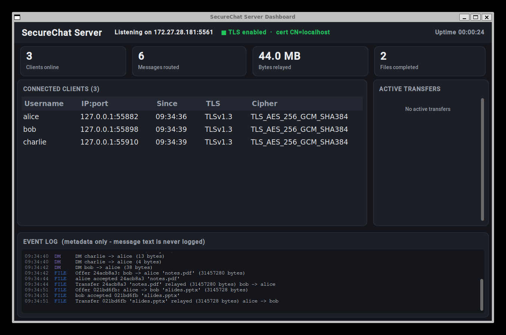
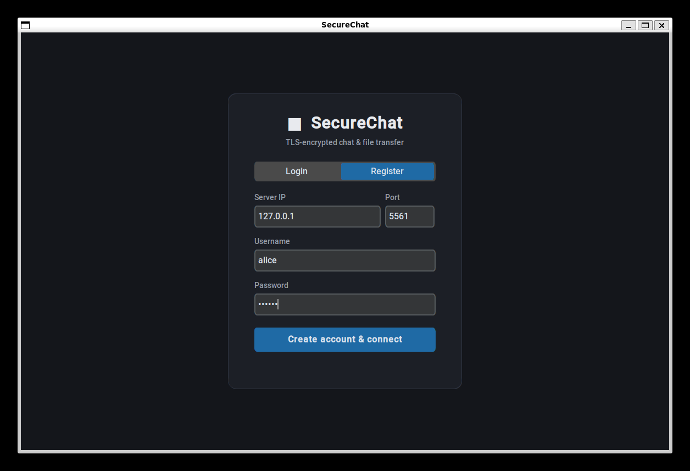
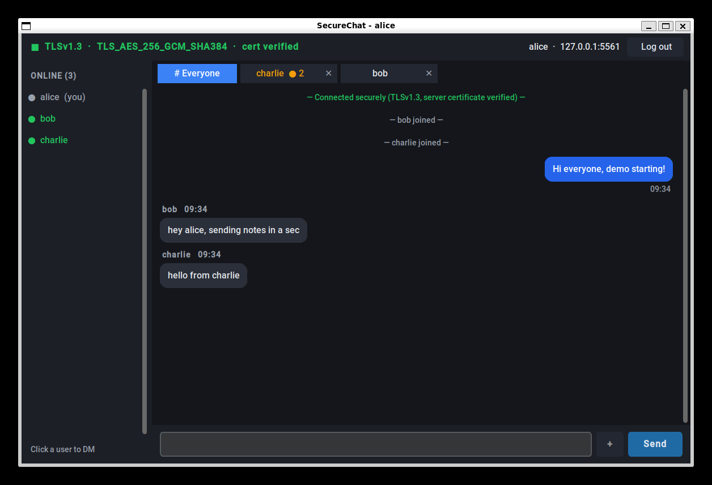
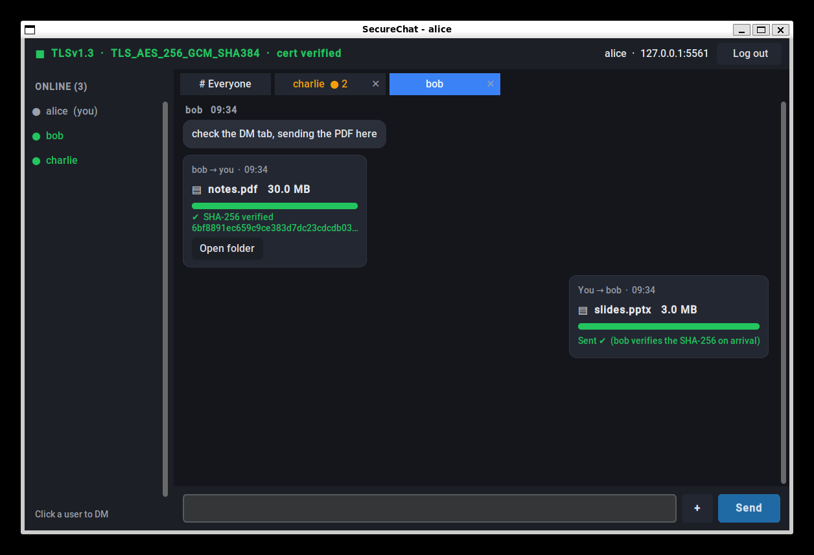
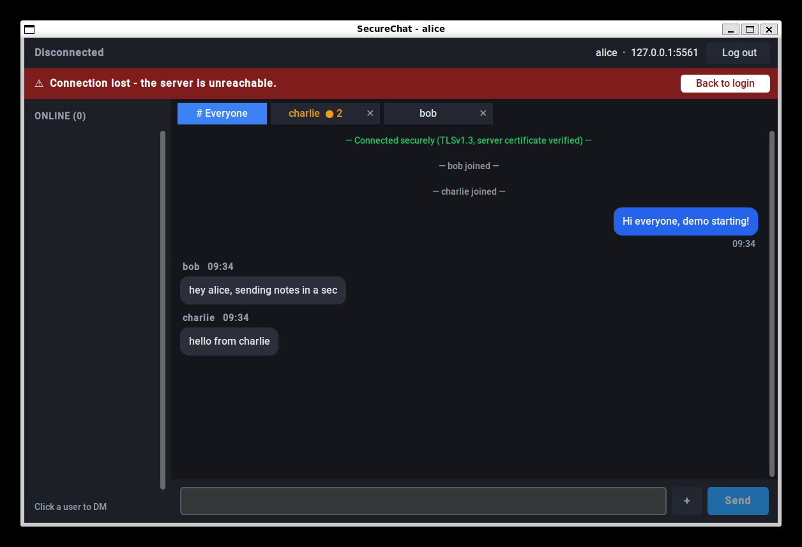

# SecureChat: TLS multi-client chat & file transfer

A Computer Networks course project. It's a multi-client chat server with private messages and file
transfer. Every byte on the wire is wrapped in TLS, and every file is checked with SHA-256 when it arrives.

- **Server:** `server.py` (CLI) or `dashboard.py` (GUI). One thread per client, length-prefixed JSON over TLS.
- **Clients:** `gui_client.py` (CustomTkinter, used in the demo) and `client.py` (CLI, for debugging).
  Both use the same networking core, `net.py`.
- **Stack:** Python 3.10+ standard library (`socket`, `ssl`, `threading`, `json`, `hashlib`), plus `customtkinter` for the GUIs.



## Quick start (one machine, 2 minutes)

```bash
pip install -r requirements.txt
python gen_cert.py
python dashboard.py                          # terminal 1: server + dashboard
python gui_client.py --user alice            # terminal 2: choose "Register" the first time
python gui_client.py --user bob              # terminal 3
```

Click `bob` in Alice's sidebar to open a DM tab, then use 📎 to send a file.

## Screenshots

| Login | Chat (# Everyone) |
|---|---|
|  |  |
| **File transfer (DM tab)** | **Server goes down** |
|  |  |

The status bar shows the live TLS version and cipher from `ssock.version()` / `ssock.cipher()`. *(These
screenshots were taken on Linux, so they show plain symbols where Windows and macOS show emoji such as 🔒 and 📎.)*

```
securechat/
├── server.py        # accept loop, per-client threads, routing, file relay
├── dashboard.py     # server GUI (runs server.py in a background thread)
├── client.py        # CLI client
├── gui_client.py    # GUI client (demo)
├── net.py           # ChatConnection: TLS socket + receiver thread + inbox queue
├── protocol.py      # send_msg / recv_msg / recv_exact  (4-byte length + JSON)
├── auth.py          # salted SHA-256 accounts in users.json
├── gen_cert.py      # creates certs/server.crt + server.key (self-signed)
├── wire_peek.py     # "eavesdropper" relay: prints the raw bytes on the wire
├── tests/           # end-to-end tests for the PRD test cases
├── docs/screenshots/
├── certs/           # server.crt (give to clients), server.key (server only!)
└── downloads/       # verified received files
```

## Setup

```bash
pip install -r requirements.txt     # just customtkinter
python gen_cert.py                  # self-signed cert, CN=localhost, SANs for localhost + LAN IP
```

`gen_cert.py` needs the `openssl` command, which ships with Git for Windows and is preinstalled on
macOS and Linux. It's equivalent to:

```bash
openssl req -x509 -newkey rsa:2048 -nodes -keyout certs/server.key -out certs/server.crt -days 365 -subj "/CN=localhost"
```

Copy the whole folder to each client laptop. Clients need `certs/server.crt` but **not** `server.key`.
Delete `server.key` from the client copies.

## Running

```bash
# Server: pick one
python dashboard.py                      # GUI dashboard (put this on the projector)
python server.py --port 5555             # headless

# Clients
python gui_client.py --host 192.168.1.10 --user alice
python client.py     --host 192.168.1.10 --user alice [--register]
```

In the GUI, choose **Register** the first time, then **Login** afterwards. Accounts are stored in `users.json` next to the server.

Useful flags (available on the server, dashboard and both clients where they make sense):

| Flag | Purpose |
|---|---|
| `--plain` | Disable TLS. Use it **only** for the Wireshark "before" capture. The server and clients must match. |
| `--port`, `--host` | Address to listen on or connect to (default `0.0.0.0:5555` / `127.0.0.1:5555`) |
| `--cafile` | Certificate the client trusts (default `certs/server.crt`) |
| `--corrupt-test` | Client flips one byte of the first chunk it sends, so the receiver shows ❌ (T6) |

### CLI client commands

| Command | Action |
|---|---|
| `<text>` | Broadcast |
| `/dm <user> <text>` | Private message |
| `/users` | List online users |
| `/send <user> <path>` | Offer a file |
| `/accept <id>` / `/reject <id>` | Answer an offer (the first few characters of the id are enough) |
| `/quit` | Disconnect |

## Protocol

Every frame is `[4-byte big-endian length][UTF-8 JSON]`, and every JSON object has a `type`. Frames over 1 MiB
are rejected, so a malicious client can't make the server allocate gigabytes.

| type | Direction | Fields | Purpose |
|---|---|---|---|
| `auth` | C→S | user, pass, mode (`login`/`register`) | First frame, within 30 s |
| `auth_ok` / `auth_fail` | S→C | user / reason | Result. The server closes the connection after `auth_fail` |
| `msg` | C→S→all | from, text, ts | Broadcast (not echoed to the sender) |
| `dm` | C→S→one | from, to, text, ts | Private message |
| `users` | both | list | Online users (also pushed on every join/leave) |
| `file_offer` | C→S→one | from, to, name, size, sha256, id | Propose a file |
| `file_accept` / `file_reject` | C→S→one | id | Receiver's answer, routed back to the sender |
| `file_chunk` | C→S→one | id, seq, data (base64 of ≤64 KB) | File data, relayed immediately |
| `file_end` | C→S→one | id | Done. The receiver re-hashes the file on disk and compares |
| `file_cancel` | both | id, reason | *Added beyond the PRD.* Abort: peer disconnected, target offline, or user cancelled |
| `sys` | S→C | text, [event, user, error] | Join/leave notices and errors |

The server **overwrites `from`** with the authenticated username, so a client can't spoof another user.

## How it works

**Concurrency (server).** The accept loop hands each socket to its own thread. The TLS handshake also
runs in that thread, so a slow or hostile client can't stall `accept()`. The shared state is
`clients{user: session}` and `transfers{id: ...}`, and each is guarded by its own `threading.Lock`.
A broadcast copies the recipient list under the lock and sends outside it. Each session has a
**send lock**, because several handler threads may write to the same socket and two frames must never
interleave.

**Framing.** TCP is a byte stream. `recv_exact(n)` loops until exactly *n* bytes have arrived, which handles
both split and merged segments (see `TestFraming`).

**File transfer.** The sender hashes the file, then sends `file_offer`. The receiver accepts, and the sender
streams 64 KB chunks (base64 inside JSON). The server forwards each chunk the moment it arrives and never
buffers the whole file, so memory stays flat for any file size. Chat frames interleave between chunks, so
chat keeps flowing during a 50 MB transfer. On `file_end` the receiver hashes **the file as written to
disk** and compares it with the offer. A mismatched file is deleted.

**Threading (GUI).** Tkinter isn't thread-safe. `net.ChatConnection` runs the receiver thread and pushes
events onto a `queue.Queue`. The GUI drains that queue with `after(50)` on the main thread. File chunks are
written to disk on the network thread, and only throttled progress events (about 10/s) reach the UI, so it
never freezes. The dashboard works the same way: `server.py` pushes events like `client_joined` and
`transfer_progress` onto a queue and never imports GUI code.

**Certificate verification.** The client's trust store is **only** `certs/server.crt`, and the system CA
store is not loaded. This pins the certificate: a server without `server.key` can't complete the handshake
(T9). Hostname checking is turned off so the demo works when connecting by LAN IP to a `CN=localhost` cert.
That's safe here because only one certificate is trusted. `gen_cert.py` also adds the LAN IP as a SAN, so
hostname checking could be turned back on.

## Tests

```bash
python -m unittest discover -s tests -v      # 23 tests, ~10 s, real TLS over loopback
```

| PRD case | How it's covered |
|---|---|
| T1 3 clients broadcast simultaneously, in order per sender | `test_T1_broadcast_order` (30 msgs each, concurrent) |
| T2 DM to offline user | `test_dm_and_T2_offline` |
| T3 duplicate login | `test_T3_duplicate_login` |
| T4 wrong password → auth_fail + closed | `test_T4_wrong_password_closes` (also checks the socket really closes) |
| T5 10 MB file verified | `test_T5_file_transfer_verified` |
| T6 corrupt chunk detected | `test_T6_corrupt_chunk_detected` (`--corrupt-test`) |
| T7 kill sender mid-transfer | `test_T7_sender_dies_mid_transfer` (receiver gets cancel + notice, server still serves, partial file removed) |
| T8 plaintext vs TLS on the wire | Wireshark, below. `wire_peek.py` shows the same thing |
| T9 wrong cert | `test_T9_wrong_cert_rejected` → "Certificate verification failed" |
| T10 50 MB while chatting | `test_chat_flows_during_big_transfer` (DM round-trip < 2 s mid-transfer); check GUI smoothness manually |
| T11 stop server with clients connected | `test_T11_server_stop_notifies_clients` → GUI shows the "Connection lost" banner |
| T12 dashboard live updates | `test_dashboard_events`; check visually during the demo |

There are also tests for garbage input, spoofed senders, registration rules, rejection, empty files, offers
to offline users, and a check that passwords never appear in `users.json`.

## Wireshark (T8)

1. Start Wireshark on the network interface (on a single machine, capture on loopback: *Npcap Loopback
   Adapter* on Windows, `lo` on Linux). Use the display filter `tcp.port == 5555`.
2. **Plain build:** `python dashboard.py --plain` and `python gui_client.py --plain`. Send a message, then
   right-click a packet → *Follow → TCP Stream*. The JSON, messages **and the password** are readable.
3. **TLS build:** the same steps without `--plain`. You see a Client Hello / Server Hello, then only
   *TLSv1.3 Application Data* records. Follow TCP Stream shows noise.

If Wireshark isn't available: `python wire_peek.py --listen 6000 --target 127.0.0.1:5555`, then connect a
client to port 6000. It prints every byte passing through the relay.

## Demo script (5 min)

1. Projector: `python dashboard.py`. Point out "Listening on …, TLS enabled".
2. Three laptops: `python gui_client.py --host <server-ip>` → Alice, Bob, Charlie. The clients table fills
   in live. Point at the 🔒 TLS version and cipher in a client's status bar.
3. Broadcast in **# Everyone**. Alice clicks Bob in the sidebar to open a DM tab.
4. Alice 📎 → PDF → Bob clicks **Accept**. Progress bars move on both clients and the dashboard →
   ✅ *SHA-256 verified* → **Open folder**.
5. Wireshark side by side: plain capture (readable) vs TLS capture (noise).
6. Close Charlie's window. The dashboard logs the leave, others see "charlie left", and the server keeps running.
7. Log in with a wrong password. The dashboard logs `AUTH FAILED`.

**Before the day:** test on the lab network (firewalls often block ports; keep a phone hotspot as backup).
Run `gen_cert.py` on the server laptop and copy `server.crt` to the clients.

## Troubleshooting

| Symptom | Fix |
|---|---|
| `Connection refused - is the server running?` | Start the server first. Check that the IP and port match. On a LAN, use the IP shown in the dashboard header, not `127.0.0.1`. |
| `Timed out connecting` (LAN) | A firewall is blocking the port. Allow Python through Windows Defender Firewall, or try a phone hotspot. |
| `Certificate verification failed` | The client's `certs/server.crt` doesn't match the server's key. Re-copy `server.crt` from the server machine after running `gen_cert.py`. |
| `Cannot load CA certificate` | `certs/server.crt` is missing on the client. Copy it over. |
| `Certificate not found` when starting the server | Run `python gen_cert.py`. |
| `Cannot start server … Address already in use` | Another server is already running on that port. Close it or use `--port 5556`. |
| `'alice' is already logged in` | That account is open in another window. Close it, or use a different user. |
| `Wrong username or password` on first run | Choose **Register** first. Accounts live in the server's `users.json`; delete that file to reset them. |
| `No module named customtkinter` | `pip install -r requirements.txt` (in the same Python you run the app with). |
| `No module named tkinter` (Linux) | `sudo apt install python3-tk` |

## Viva notes and limitations

- **Is it end-to-end encrypted?** No. TLS protects each hop (client↔server), and the server decrypts and can
  read everything it relays. E2EE would need per-client key pairs (X25519/RSA) and encryption done on the
  client, with the server relaying only ciphertext.
- **Passwords:** stored salted with SHA-256 and compared in constant time. They're never stored in plain text
  and only travel inside TLS. SHA-256 is fast, which makes brute force cheap if `users.json` leaks;
  bcrypt/scrypt/argon2 is the fix. Login failures use the same message for "no such user" and "wrong
  password". There's no rate limiting.
- **Self-signed cert:** fine for a LAN where we hand out `server.crt` ourselves. On the internet you'd use a CA.
- **Thread per client:** simple and fine for under 50 clients. `selectors`/`asyncio` would scale further.
- **Slow receivers:** a client that stops reading will eventually block the thread relaying to it. A real
  deployment would add send timeouts and per-client outbound queues.
- **Emoji on Linux:** some Linux Tk builds crash on colour-emoji fonts, so Linux falls back to plain
  symbols. Set `SECURECHAT_EMOJI=1` to force emoji.

## Future work

E2EE with per-client keys · bcrypt/argon2 · rooms · SQLite message history · web client via a WebSocket
bridge · resumable transfers · typing indicators and read receipts · login rate limiting.
